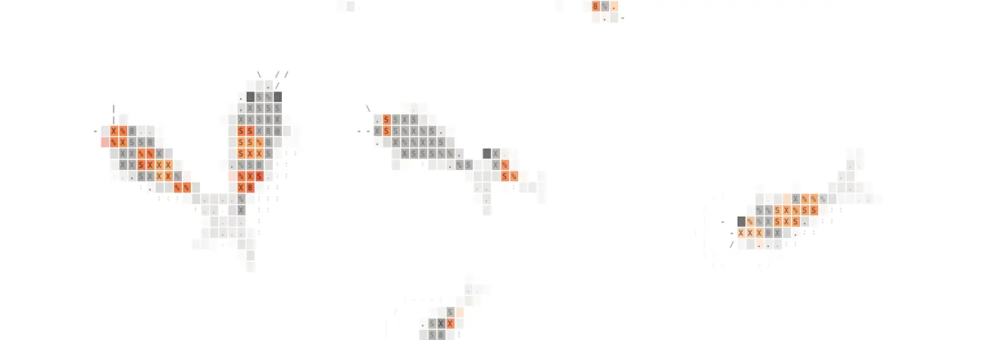

<a href="https://acuherb.xyz">
  <picture>
    <source media="(prefers-color-scheme: dark)" srcset="pond-dark.webp" />
    
  </picture>
</a>

# 观颐斋 · AcuHerb

入经典之门，行颐养之路。

我在这里记录研习、整理、思考，也在构建一个安静、清晰、可持续的数字空间。

---

## 👤 关于我
习惯在纷杂里找一条安静的路。  
读经典，不为猎奇，只为把一件事看得更深一点。  
写博客，不为热闹，只为把思路整理得更清楚一点。  

在传统医学与数字世界之间行走：  
一手翻书，一手敲键盘。  
用代码搭建秩序，用文字沉淀理解。  

相信长期主义，相信慢慢来会比较快。  
愿所学能自用，所思能自明。

---

## 📚 研习方向
- 黄帝内经 · 阴阳五行  
- 针灸经络 · 腧穴体系  
- 本草药性 · 四气五味  
- 伤寒金匮 · 六经辨证

---

## 📝 写作与整理
- 博客：**https://acuherb.xyz**  
- 基于 Hugo + FixIt  
- 自动化构建与部署（GitHub Actions）  
- 以“可读、可查、可持续”为原则整理内容

---

## 🔧 技术栈

---

## 🎯 当前关注
- 优化内容结构与长期可维护性  
- 研读经典，整理知识体系  
- 探索数字化与传统医学的结合方式

---

## 🌱 小小愿景
愿以文字与代码，  
记录所学，  
沉淀所思，  
与同道共勉。

---

## 🆕 最新文章
<!-- BLOG-POST-LIST:START -->- 📝 [阴阳相合：男女结合背后的经络气血运行图](https://acuherb.xyz/posts/yihua-13-yinyangxianghe/) · YYYY-20-DD
- 📝 [学习导读](https://acuherb.xyz/posts/study-guide/) · YYYY-15-DD
- 📝 [跋](https://acuherb.xyz/posts/7-1-ba/) · YYYY-11-DD
- 📝 [痈疽并无名疮毒](https://acuherb.xyz/posts/6-22-yongdoubingwumingchuangdu/) · YYYY-51-DD
- 📝 [汤火伤：火烧 汤池](https://acuherb.xyz/posts/6-22-tanghuoshang/) · YYYY-36-DD
<!-- BLOG-POST-LIST:END -->
